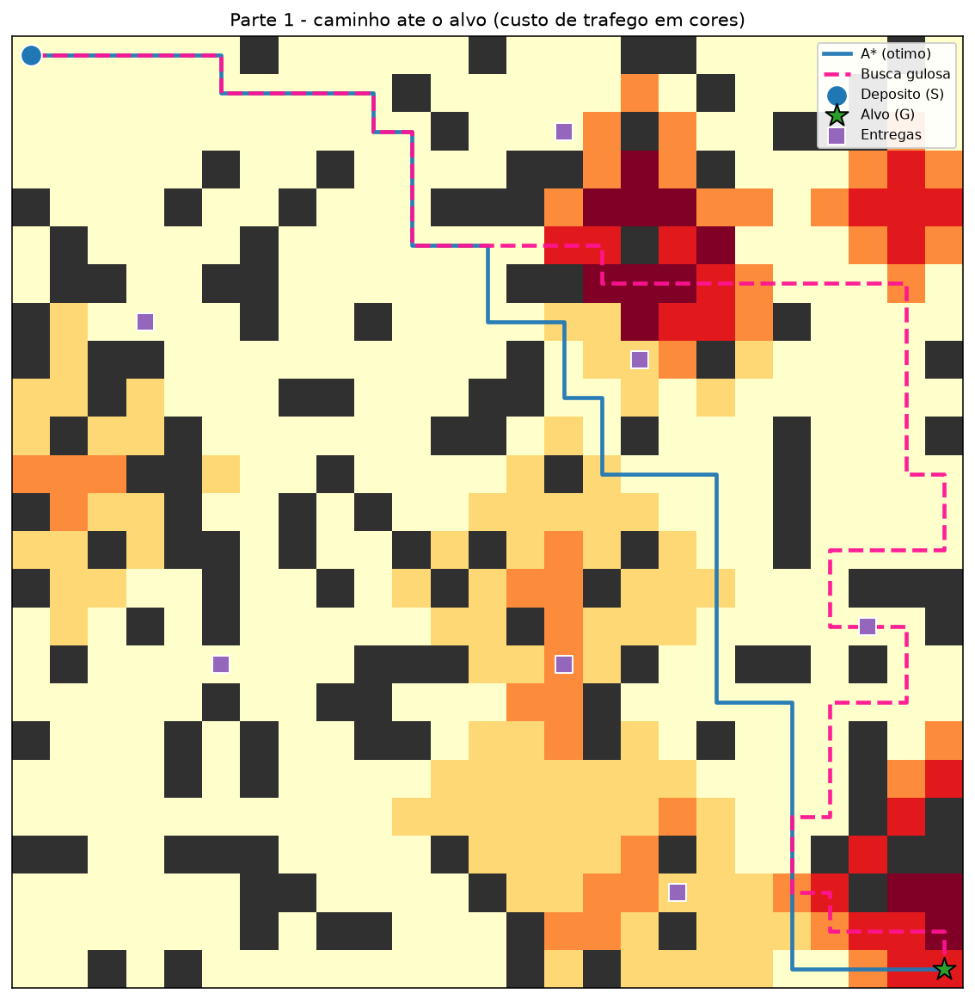
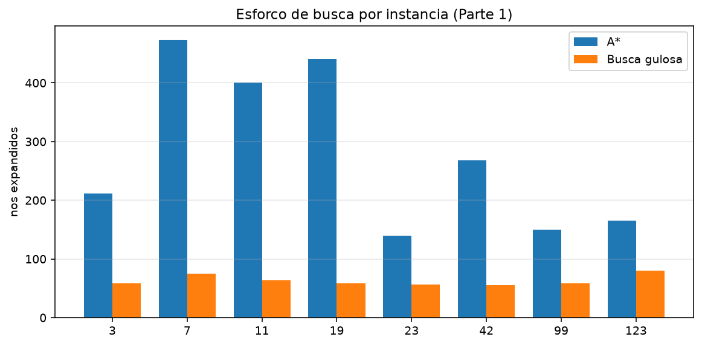
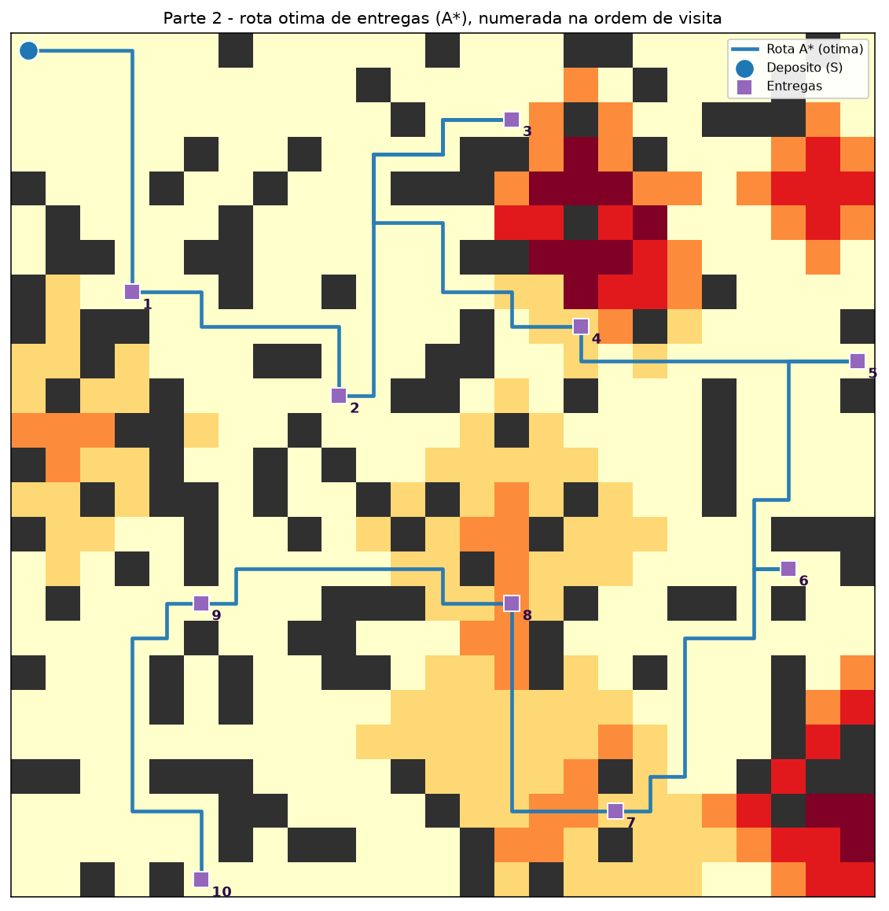
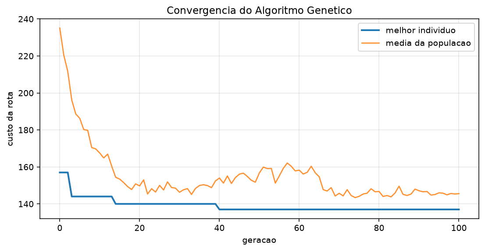

# Rota do Entregador — busca com A\* e AG

**Disciplina:** Inteligência Artificial
**Aluno:** Mariana de Freitas
**Tema:** problema de busca em espaço de estados — caminho mínimo e roteirização de entregas

Implementação em Python de um problema de **entrega de pacotes em uma cidade em grade**,
resolvido com **A\***, **AG (busca gulosa)** e **AG (algoritmo genético)**, comparados
com as referências exatas (Dijkstra e força bruta).

> O enunciado pede "A\* e AG". Como a sigla é ambígua, o trabalho entrega **as duas
> leituras**: **AG = busca gulosa** (Parte 1 e 2) e **AG = algoritmo genético** (Parte 2),
> comparando os três. Assim o trabalho cobre o que o professor pedir, e ainda rende
> uma análise extra de qualidade × esforço.

---

## 1. O problema

Uma transportadora tem um depósito e precisa entregar 10 pacotes em pontos espalhados
pela cidade. A cidade é uma grade 25 × 25:

- células escuras são **prédios** (intransponíveis);
- cada célula livre tem um **custo de entrada** de 1 a 5 (1 = via livre, 2–5 =
  congestionamento). O custo é o tempo/combustível para atravessar o quarteirão;
- o entregador sai do depósito `(0,0)` e **não precisa voltar** ao final.

O problema tem duas decisões encadeadas, o que dá dois níveis de busca:

1. **Caminho:** qual o trajeto de menor custo entre dois pontos da grade?
2. **Ordem:** em que sequência visitar as 10 entregas para minimizar o custo total?

Formalmente, para a Parte 2:

| Elemento | Definição |
|---|---|
| Estado | `(ponto_atual, conjunto_de_entregas_restantes)` |
| Ação | ir até uma entrega ainda não visitada |
| Custo | custo do caminho mínimo na grade entre os dois pontos |
| Estado inicial | `(depósito, todas as entregas)` |
| Teste de objetivo | nenhuma entrega restante |
| Solução ótima | caminho de menor custo total |

Para 10 entregas existem `10! = 3.628.800` ordens possíveis — o espaço de busca é
combinatório, por isso comparar algoritmos faz sentido.

---

## 2. Algoritmos implementados

### 2.1 A\* (Parte 1 e Parte 2)

Avalia cada nó por

$$f(n) = g(n) + h(n)$$

- `g(n)`: custo real do depósito até `n`;
- `h(n)`: estimativa do custo de `n` até o objetivo.

**Heurística da Parte 1:** `h(n) = distância_de_Manhattan(n, objetivo) × custo_mínimo_da_grade`.
Como todo passo custa pelo menos `custo_mínimo`, `h` **nunca superestima** (admissível)
e ainda satisfaz a consistência:

$$h(u) \le c(u,v) + h(v)$$

Logo o A\* é **ótimo** e pode fechar nós sem reabri-los. Neste trabalho a garantia é
verificada experimentalmente contra o Dijkstra em todas as instâncias.

**Heurística da Parte 2:** `h(estado) = peso da árvore geradora mínima (AGM)` sobre
`{ponto_atual} ∪ entregas_restantes`. Qualquer rota que visite todas essas entregas
contém uma árvore geradora desses vértices, então o custo da rota é ≥ peso da AGM:
a heurística é admissível. Isso poda o espaço de 6.144 estados para **116 expansões**
na instância principal.

### 2.2 Busca gulosa — "AG guloso" (Parte 1 e Parte 2)

Ordena a fronteira **somente por `h(n)`**, ignorando o custo já gasto:

$$f(n) = h(n)$$

- Parte 1: vai sempre na célula que "parece mais perto" do alvo.
- Parte 2: vizinho mais próximo (nearest neighbour) — sempre a entrega mais perto.

É **rápido**, mas **não garante o ótimo**: pode entrar em zona de congestionamento
porque `h` não vê o custo do desvio (veja a Figura 1), e na roteirização pode deixar
um ponto isolado para o final.

### 2.3 Algoritmo Genético — "AG genético" (Parte 2)

| Componente | Escolha |
|---|---|
| Indivíduo | permutação das 10 entregas (depósito fixo no início) |
| Aptidão | `1 / custo_total` (minimização do custo) |
| Seleção | torneio de 3 |
| Crossover | OX (order crossover), taxa 0,9 |
| Mutação | troca de duas posições ou inversão de trecho, taxa 0,3 |
| Elitismo | 2 melhores passam intactos |
| Parada | 300 gerações ou 60 gerações sem melhora |
| População | 80 indivíduos, 20 execuções independentes por instância |

O OX preserva a **ordem relativa** das entregas, que é exatamente o que importa no
problema (o valor absoluto da posição não significa nada).

### 2.4 Referências exatas (verificação)

- **Dijkstra** (custo uniforme) na grade → prova que o A\* da Parte 1 é ótimo.
- **Força bruta** sobre todas as permutações → prova que o A\* da Parte 2 é ótimo
  (10 entregas = 362.880 ordens, ~3,3 s em Python).

---

## 3. Como executar

Requisitos: Python 3.10+ e `numpy`/`matplotlib` (só para os gráficos).

```bash
pip install -r requirements.txt
python main.py
```

Saídas em `resultados/`:

| Arquivo | Conteúdo |
|---|---|
| `mapa_parte1.png` | A\* × guloso no mesmo mapa |
| `mapa_parte2_rota.png` | rota ótima numerada na ordem de visita |
| `convergencia_ag.png` | melhor indivíduo e média da população por geração |
| `comparacao_expansoes.png` | nós expandidos por instância |
| `tabelas.md` | tabelas prontas para o relatório |
| `parte1_instancias.csv`, `parte2_resumo.csv`, `parte2_ag_execucoes.csv` | dados brutos |
| `saida.txt` | log completo da execução |

Tudo é determinístico (sementes fixas), então os números se repetem.

---

## 4. Resultados

### 4.1 Parte 1 — caminho mínimo na grade (8 cidades)

Cada linha é uma cidade diferente (semente). "Ótimo" veio do Dijkstra.

| Inst. | Ótimo | Custo A\* | Custo guloso | Nós A\* | Nós guloso | Guloso/A\* (%) | Custo extra (%) |
|---:|---:|---:|---:|---:|---:|---:|---:|
| 3 | 60 | 60 | 74 | 212 | 59 | 27,8 | 23,3 |
| 7 | 62 | 62 | 105 | 473 | 75 | 15,9 | 69,4 |
| 11 | 60 | 60 | 70 | 400 | 64 | 16,0 | 16,7 |
| 19 | 58 | 58 | 97 | 441 | 59 | 13,4 | 67,2 |
| 23 | 48 | 48 | 88 | 140 | 56 | 40,0 | 83,3 |
| 42 | 53 | 53 | 81 | 268 | 55 | 20,5 | 52,8 |
| 99 | 59 | 59 | 102 | 150 | 58 | 38,7 | 72,9 |
| 123 | 49 | 49 | 84 | 165 | 80 | 48,5 | 71,4 |

**Resumo:** o A\* acertou o ótimo em **8/8** instâncias. O guloso expandiu em média
**63,2 nós contra 281,1 do A\*** (só **27,6 %** do esforço), mas pagou em qualidade:
custo médio **57,1 % maior**, chegando a **+83,3 %**, e foi subótimo em **8/8** casos.



*Figura 1 — o guloso (rosa tracejado) "corta caminho" pela zona vermelha de
congestionamento porque só olha a distância em linha reta; o A\* (azul) contorna e
chega com custo 62 contra 105.*



### 4.2 Parte 2 — ordem de entrega (instância principal: semente 7, 10 entregas)

| Algoritmo | Custo da rota | Gap vs ótimo (%) | Expansões | Tempo (ms) |
|---|---:|---:|---:|---:|
| **A\* (ótimo)** | **137** | 0,00 | 116 | 7,6 |
| Guloso (vizinho mais próximo) | 157 | 14,6 | — | 0,02 |
| AG genético (melhor de 20) | 137 | 0,0 | — | 83,1 |
| AG genético (média de 20) | 139,45 | 1,8 | — | 83,1 |
| AG genético (pior de 20) | 144 | 5,1 | — | 83,1 |
| Força bruta (verdade) | 137 | 0,00 | 362.880 ordens | 3.308 |

O A\* achou o mesmo valor da força bruta (**137**) expandindo apenas **116** dos
6.144 estados possíveis — a heurística de AGM podou quase tudo: **~700× mais rápido**
que enumerar as 362.880 ordens.



*Figura 2 — rota ótima (custo 137), numerada na ordem de visita. Note que o guloso
começa igual, mas troca a ordem no meio e termina 14,6 % mais caro.*



*Figura 3 — convergência do AG: o melhor indivíduo cai de 157 (solução gulosa usada
na população inicial) para 137 em ~40 gerações; a média da população também desce,
indicando que a seleção está funcionando.*

### 4.3 Parte 2 — resumo em 5 cidades (20 execuções do AG em cada)

| Inst. | Ótimo | Guloso | Gap guloso (%) | AG melhor | AG média | Gap AG médio (%) | Ótimos do AG |
|---:|---:|---:|---:|---:|---:|---:|---:|
| 7 | 137 | 157 | 14,6 | 137 | 139,4 | 1,8 | 7/20 |
| 21 | 178 | 198 | 11,2 | 178 | 178,3 | 0,2 | 19/20 |
| 34 | 140 | 177 | 26,4 | 140 | 142,0 | 1,4 | 14/20 |
| 55 | 152 | 156 | 2,6 | 152 | 152,0 | 0,0 | 20/20 |
| 89 | 147 | 147 | 0,0 | 147 | 147,0 | 0,0 | 20/20 |

**Resumo:** o guloso erra em média **+11,0 %** (chega a +26,4 %). O AG genético fica
em média a **0,68 %** do ótimo, encontra o ótimo em **80 de 100** execuções e, na
melhor execução, acerta o ótimo em **todas as 5 instâncias**.

### 4.4 Verificações de corretude

- A\* = Dijkstra em **8/8** instâncias da Parte 1 (custo idêntico ao ótimo);
- A\* = força bruta em **5/5** instâncias da Parte 2;
- custo da rota reconstruída célula a célula confere com o custo da matriz de
  distâncias (asserções no código).

---

## 5. Discussão

**Qualidade × esforço.** O A\* é o único que **garante** o ótimo, e a heurística
correta torna isso barato: 281 nós (Parte 1) e 116 estados (Parte 2). O guloso é
mais rápido, mas troca garantia por velocidade: na grade ele é **57 % pior em média**
porque a heurística ignora o custo do terreno; na roteirização ele erra a ordem em
quase todas as instâncias não triviais.

**O AG genético não é “mágico”.** Ele não garante o ótimo, mas chega muito perto:
0,68 % de gap médio e 80 % de acertos exatos, com custo computacional de ~83 ms por
execução — barato para 10 entregas, e a diferença cresce a favor dele quando o número
de entregas aumenta (o A\* sobre subconjuntos é `O(n · 2^n)`, enquanto o AG é
`O(gerações × população × n)`).

**Comparação justa.** Os três atacam o mesmo espaço de busca, mas com estratégias
diferentes:

| Algoritmo | Garante ótimo? | Esforço | Quando usar |
|---|---|---|---|
| A\* | Sim | Médio (podado pela heurística) | quando a resposta precisa ser exata e o espaço é tratável |
| Guloso | Não | Muito baixo | tempo real, solução “boa o suficiente”, ou para gerar solução inicial |
| AG genético | Não | Alto (mas escala melhor) | instâncias grandes/combinatórias, onde o ótimo é caro demais |

**Limitações do modelo.** Grade 4-vizinhança (não permite diagonais), custos
estáticos (não modela trânsito mudando), e a cidade é sintética. A modelagem em
grafo é a mesma usada em logística real, então os algoritmos se transferem
diretamente.

---

## 6. Complexidade

| Algoritmo | Tempo | Espaço | Comentário |
|---|---|---|---|
| Dijkstra | `O(E log V)` | `O(V)` | referência de otimalidade |
| A\* | `O(E log V)` no pior caso, muito menos na prática | `O(V)` | depende da qualidade de `h` |
| Busca gulosa | `O(E log V)` no pior caso | `O(V)` | mesmo custo assintótico, sem garantia de ótimo |
| AG genético | `O(G · P · n)` | `O(P · n)` | `G` gerações, `P` população |
| Força bruta | `O(n!)` | `O(n)` | inviável acima de ~12 entregas |

Para 10 entregas: 6.144 estados no A\* da Parte 2 contra 3.628.800 permutações na
força bruta.

---

## 7. Conclusão

O trabalho modela um problema de entrega com dois níveis de decisão e mostra, com
números, o compromisso central de busca heurística:

- **A\* com heurística admissível é ótimo e eficiente** — 8/8 e 5/5 instâncias
  confirmadas contra Dijkstra e força bruta;
- **a busca gulosa é a mais rápida e a menos confiável** — 27,6 % do esforço do A\*,
  porém até 83 % mais cara na grade e ~11 % pior na roteirização;
- **o AG genético é o melhor “custo-benefício” quando o espaço explode** — 0,68 % de
  gap médio e 80 % de ótimos exatos, com tempo desprezível para 10 entregas.

Na prática: use A\* quando precisar de garantia; use guloso para uma resposta
imediata ou solução inicial; use AG quando a instância crescer a ponto de o A\* não
fechar.

---

## 8. Estrutura do projeto

```
trabalho-busca-a-star-ag/
├── problema.py        # grade, geração da cidade, custos, utilidades
├── busca.py           # A*, busca gulosa, Dijkstra, heurísticas
├── roteirizacao.py    # matriz de distâncias, A* sobre subconjuntos, guloso, força bruta
├── genetico.py        # AG: OX, torneio, mutação, elitismo, estatísticas
├── main.py            # experimentos, tabelas, CSV e figuras
├── requirements.txt
├── ROTEIRO_APRESENTACAO.md
└── resultados/        # tabelas, CSV, PNG e log gerados
```

> Roteiro de apresentação (6–8 min) em [`ROTEIRO_APRESENTACAO.md`](ROTEIRO_APRESENTACAO.md).
